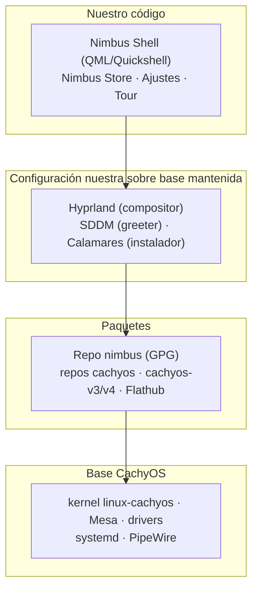

# Arquitectura de Nimbus

> **Note for English-speaking contributors:** these docs are written in Spanish first. An English version will follow.

Cómo encajan las piezas. La fuente de verdad es el [documento de diseño](superpowers/specs/2026-10-21-nimbus-design.md) (§4); aquí se resume lo implementado y se marca lo pendiente.

## Capas

En texto: el shell y las apps propias arriba; Hyprland, SDDM y Calamares en medio (mantenidos por otros, configurados por nosotros; Calamares se usa vía el fork que ya mantiene CachyOS); los repositorios de paquetes debajo; la base CachyOS al fondo. Solo la capa superior es código Nimbus.

## El modelo de pins

La base rueda; el escritorio, no. `linux-cachyos`, Mesa, systemd y los drivers siguen a los repos de CachyOS en rolling. Hyprland, Quickshell, las librerías Qt, el shell y los reempaquetados de AUR viven en el repo propio `nimbus` y solo llegan al usuario cuando se **promueven** de `testing` a `stable`.

El mecanismo: la CI compila y publica binarios en `testing` sin firmar; alguien prueba la ISO y ejecuta `tools/promote.sh` con la clave offline, que copia los paquetes a `stable`, regenera la DB con `repo-add` y la firma. Si Hyprland rompe su API, la rotura se queda en `testing` y el usuario de `stable` no se entera. El coste es real: alguien tiene que rebasear el desfase con upstream, por eso el stack pineado se mantiene lo más pequeño posible.

Qué rueda y qué se pinea, en detalle: [../packages/README.md](../packages/README.md).

## Repo y firma: `testing` frente a `stable`

- Hay un solo repo pacman (`nimbus`) con dos canales: `testing` (lo último compilado, sin garantías) y `stable` (lo promovido a mano, lo que recibe el usuario).
- La promoción es un acto manual con la clave GPG offline: `tools/promote.sh --from <testing> --to <stable> --gpgdir <disco-offline> --key <fingerprint>`. Es atómica (o se copia todo o no se copia nada) y se niega a sobrescribir una versión ya publicada.
- `tools/verify_repo.sh --repo <dir> --gpgdir <dir>` comprueba la firma de la DB y de cada paquete; un paquete sin `.sig` contigua cuenta como fallo.
- **La CI nunca firma.** Compila y prueba; la firma solo ocurre en la máquina offline. La clave maestra no existe en ningún runner, en ningún artefacto ni en ningún repositorio.
- **El repo local de bootstrap va sin firmar.** Durante el bootstrap el repo `nimbus` aún no está alojado, así que `iso/build.sh --local-repo` sirve los PKGBUILDs compilados por `file://` y la sección `[nimbus]` del `pacman.conf` del perfil lleva `SigLevel = Optional` con un `# TODO(bootstrap)` visible. Es un apaño temporal de construcción, no el modelo de firma: cuando el repo público esté alojado y firmado, esa sección pasa a `SigLevel = PackageRequired DatabaseOptional`. Detalles en [BUILDING.md](BUILDING.md) (§ "El flag `--local-repo` y por qué existe") y en el contrato de `packages/nimbus-keyring`.
- La rotación de clave es un procedimiento de 6 pasos documentado en [../packages/README.md](../packages/README.md): generar clave nueva offline, re-firmar el repo, publicar el keyring nuevo con ambas claves, retirar la antigua.

## Cadena de confianza

1. `tools/genkeyring.sh` genera una clave RSA-4096 sin passphrase en una máquina offline y exporta la clave pública en ASCII armored (`nimbus.gpg`), más `nimbus-trusted` (ownertrust con nivel 6 para ese fingerprint) y `nimbus-revoked` (vacío, reserva para revocaciones).
2. El paquete `nimbus-keyring` instala esos tres ficheros en `/usr/share/pacman/keyrings/`.
3. Su hook `post_install` ejecuta `pacman-key --populate nimbus`, que importa la clave pública y le aplica la confianza del ownertrust.
4. `pacman` ya puede verificar las firmas de la DB (`nimbus.db.sig`) y de cada paquete del repo `nimbus`.
5. Las actualizaciones (`nimbus-update`, pendiente: hito M3) aplican `pacman -Syu` + Flatpaks con snapshot previo automático.

Sobre el formato de `nimbus.gpg`: debe ser la **exportación armored de la clave pública** (empieza por `-----BEGIN PGP PUBLIC KEY BLOCK-----`), igual que `cachyos.gpg` y `archlinux.gpg`. No sirve un keybox: `pacman-key --populate` importa el fichero con `gpg --import`, y `gpg --import` solo acepta exportaciones de clave, no bases de datos de keyring. Con un keybox responde "no valid OpenPGP data found", la clave entra sin confianza y **todas** las firmas del repo fallan. Es el tipo de detalle que rompe todo en silencio; por eso hay un test dedicado (`keyring.bats`: "nimbus.gpg es importable con gpg --import").

Sobre la clave que hay hoy en el repo: es una **clave de bootstrap de prueba**, generada en local (`Nimbus Bootstrap`, fingerprint `C069CB59A56B325AFE82C05A1AB48981EB7BDCC7`). Su mitad privada está fuera de cualquier custodia documentada y **hay que rotarla antes de cualquier beta o publicación**, siguiendo los 6 pasos de [../packages/README.md](../packages/README.md) (§ "Rotación de clave" y § "Custodia de la clave offline"). Al repo solo se sube la mitad pública, que es la que se distribuye a los usuarios.

## Arquitectura del shell

El shell es una app **Quickshell** (QML) sobre **Hyprland**. La API de Quickshell 0.3.2 que usa el proyecto, **verificada leyendo el `.qmltypes` del paquete** durante M0:

- la raíz de una config es **`ShellRoot`** (`import Quickshell`);
- `PanelWindow`, `FloatingWindow` y `PopupWindow` se importan con **`import Quickshell.Wayland`** (no `Window` de QtQuick ni un `Loader` cargando otro fichero);
- los servicios (`Notifications`, `Polkit`, `Pam`, `Mpris`, `UPower`, `SystemTray`, `Pipewire`, `Greetd`) están en **`Quickshell.Services`**.

El módulo propio `Nimbus` se registra con un `qmldir` en **`shell/src/Nimbus/`** (no en `shell/src/`): QML resuelve un módulo buscando un **directorio** con ese nombre en el `QML2_IMPORT_PATH`, así que un `qmldir` plano en `shell/src/` **no** funciona. El import path debe ser su padre, `shell/src`. Fijado por `tests/test_shell_entrypoint.py`.

### Estructura de `shell/src/Nimbus/`

Punto de entrada: `shell/src/shell.qml` (raíz `ShellRoot`; monta cada superficie tras un `Loader` con vigilancia de `status`, ver "Aislamiento de fallos" abajo). El launcher (`shell/nimbus-shell`) ejecuta `qs -c /usr/lib/nimbus/shell/src`.

| Zona | Contenido |
|------|-----------|
| Singletons | `Theme`, `Config`, `Translations`, `ShellController`, `Ipc`, `Services`, `PolkitAgent` (todos con `pragma Singleton`, registrados en el `qmldir` con su línea `singleton <Nombre> 1.0 <Fichero>.qml`). |
| `lib/` | Biblioteca de componentes compartidos: `Button`, `Glass`, `Icon`, `ListRow`, `Popup`, `SearchField`, `SectionHeader`, `Slider`, `Toggle`, `Tooltip`. |
| `modules/` | Superficies: `TopBar`, `TopBarMenu`, `Dock` (+ `DockItem`), `Spotlight`, `ControlCenter`, `Notifications`, `Switcher`, `Screenshot`, `QuickLook`, `Wallpaper`, `LockScreen`. |
| `apps/` | Aplicaciones: Ajustes (`Settings/` con 11 páginas), Store (`Store/` con `Store`, `StoreHome`, `StoreDetail`, `StoreUpdates` más `store_backend.py` con backend Flatpak y fallback nativo) y tour (`Tour/` con `Tour` y `TourStep`). |

Qué hace cada singleton:

- **`Theme`** (`shell/src/Nimbus/Theme.qml`) — tokens de diseño de solo lectura: colores de fondo/superficie/texto/separador/acento para modo claro y oscuro, material de cristal (`glass`) con su fallback opaco (`glassOpaque`), métricas (`radius` 12, `spacing` 8, `barHeight` 28, `dockSize` 64), tipografía (`Inter`) y constantes de superficies y animaciones del contrato M1 (`spotlightMaxWidth` 640, `switcherWidth` 800, `animStandard` 150…). `setMode("light"|"dark"|"auto")` cambia el esquema; `setAccent(color)` fija el acento elegido, que gana en ambos modos.
- **`Config`** (`shell/src/Nimbus/Config.qml`) — configuración persistida con versionado (`schemaVersion`, hoy 2): `mode`, `accent` (hex en minúsculas, sin `#`), `locale` (código BCP-47) y `tourCompleted`. `migrateFrom(n)` migra esquemas antiguos sin romper el arranque; `translated(clave)` resuelve cadenas en el idioma activo.
- **`Translations`** (`shell/src/Nimbus/Translations.qml`) — tabla ES/EN con fallback: idioma activo → inglés → la propia clave.
- **`ShellController`** (`shell/src/Nimbus/ShellController.qml`) — propietario de qué superficie está abierta (ver "Una sola superficie abierta" abajo).
- **`Ipc`** (`shell/src/Nimbus/Ipc.qml`) — bus IPC (ver "Contrato IPC" abajo).
- **`Services`** (`shell/src/Nimbus/Services.qml`) — adaptador de servicios con estado plano (bool, string, number, list), sin tipos de Quickshell en la API pública para que los tests no dependan del framework. Sin D-Bus todo vale `false`/`"unknown"` y el shell arranca igual; el cableado a los servicios reales entra detrás de los mismos flags `...Available`.
- **`PolkitAgent`** (`shell/src/Nimbus/PolkitAgent.qml`) — agente de polkit propio (sin KDE ni GNOME instalados, `polkit-gnome` sería una ventana ajena al diseño). Defensivo: si el bus no está disponible el shell arranca igual y las acciones privilegiadas aparecen deshabilitadas con un mensaje. Nunca guarda la contraseña.

### La regla de oro

Todo componente visible lee sus colores, radios y métricas de **`Theme`**, y todo texto visible pasa por **`Config.translated(clave)`**. Una clave ausente **cae al inglés**, y si tampoco está en inglés, se devuelve **la propia clave** (nunca se queda una cadena vacía en pantalla). El test `test_shell_entrypoint.py` caza literales sueltos: asignar texto visible a las propiedades `text`, `title`, `label`, `placeholderText`, `tooltip`, `description`, `message` o `subtitle`, o un color hex literal fuera de `Theme`, falla el test.

### Contrato IPC

El bus es `nimbus-shell ipc call <target> <función>`: `shell.qml` expone un `IpcHandler` con target `nimbus` que delega en `Ipc.call(target, fn)`, y los binds de Hyprland (`dots/hypr/hyprland.lua`) lo invocan desde el teclado. La tabla de targets y funciones válidas vive en `Ipc.validCalls`; ante un target o una función desconocidos **no lanza**: avisa por `console.warn` y no cambia `lastTarget`/`lastFunction`. Un fallo nunca tumba el shell.

| Target | Funciones | Efecto |
|--------|-----------|--------|
| `dock` | `toggle`, `open`, `close` | Mostrar/ocultar el Dock |
| `spotlight` | `toggle`, `open`, `close`, `apps`, `files` | Abrir el buscador |
| `switcher` | `next`, `prev`, `commit`, `cancel` | Cambiar de ventana |
| `screenshot` | `region`, `window`, `screen` | Captura |
| `quicklook` | `toggle`, `open`, `close` | Vista rápida |
| `wallpaper` | `toggle`, `open`, `close`, `next`, `prev` | Fondos |
| `controlcenter` | `toggle`, `open`, `close` | Centro de control |
| `notifications` | `toggle`, `clear` | Notificaciones (`clear` vacía la cola vía `Services`) |
| `settings` | `open` | Abrir los Ajustes |
| `store` | `open` | Abrir la Store |
| `tour` | `start` | Reabrir el tour (llega como `surfaceRequested("tour", "start")`) |
| `lock` | `lock` | Cierra todo y bloquea (llega como `surfaceRequested("lock", "lock")`) |

`toggle`/`open`/`close` pasan por `ShellController` (exclusividad de superficies); las acciones con argumento viajan como `surfaceRequested(target, fn)` y las consumen sus superficies. Binds fijados en `dots/hypr/hyprland.lua`: `SUPER+D` → `dock toggle`, `SUPER+Espacio` → `spotlight toggle`, `SUPER+Tab` → `switcher next`, `Impr Pant` → `screenshot region`. El resto de atajos (terminal, cerrar ventana, copiar/pegar, workspaces 1–9, bloqueo, sesión de emergencia con terminal) son llamadas directas del compositor, no IPC del shell.

### Una sola superficie abierta

`ShellController` garantiza **una sola superficie abierta a la vez**: `open(surface)` cierra la anterior; los nombres sin booleano dedicado (p. ej. `"settings"`, `"store"`) se gestionan de forma genérica vía `activeSurface`. Es lo que hace que el shell se sienta como un sistema y no como cuatro ventanas sueltas. El tour solo se muestra en el primer arranque (`!Config.tourCompleted`).

### Aislamiento de fallos

Cada módulo del `shell.qml` va tras un `Loader` con vigilancia de `status`: si uno falla al cargar, `onStatusChanged` cuenta el fallo en `moduleFailures` (propiedad del `shell.qml`) y **el shell sigue arrancando**. Como QML no tiene try/catch, la guarda es `status === Loader.Error`. Cubierto por `shell/tests/tst_controller.qml`.

## Instalador Calamares

Calamares (vía el fork que ya mantiene CachyOS, `cachyos-calamares-next`) con seis módulos propios en `installer/calamares/modules/`:

- **`nimbus-dualboot`** — arranque dual con Windows: detecta la instalación, detecta Fast Boot (si está activo **bloquea** con el mensaje que explica cómo desactivarlo) y respalda la tabla de particiones con `nimbus-partitionsafe backup`. Reutiliza la partición EFI existente y avisa a los pasos siguientes para que `bootloader` use GRUB.
- **`nimbus-appearance`** — dos páginas (tema claro/oscuro/auto, 12 presets de acento); escribe `/etc/nimbus/appearance.conf` y lo aplica con `kwriteconfig`.
- **`nimbus-software`** — perfiles de software (`base`, `gaming`, `creative`, `development`, `communication`, `office`, definidos en `nimbus-software.conf`); comprueba conectividad antes de empezar e instala con `pacman -S --needed --noconfirm` vía `target_env_command`.
- **`nimbus-bootloader`** — elige **GRUB** si hay Windows y **systemd-boot** si el disco es solo de Nimbus. Sobre Btrfs el menú ofrece además `Nimbus (última versión conocida buena)` y `Nimbus (modo seguro)`; sin Btrfs instala el kernel LTS `linux-cachyos-lts` como red de seguridad. Sin Btrfs real en CI, la lógica es inyectable (`snapshot_provider`).
- **`nimbus-postinstall`** — invoca `installer/tools/nimbus-postinstall --root <raíz>`: deja el sistema listo (keyring, repos, confianza, servicios, greeter, energía, híbridos, skel). Un paso opcional que falla avisa pero no hunde el job; uno crítico (keyring o repos) sí lo hace fracasar.
- **`nimbus-verify`** — 14 comprobaciones sobre el sistema instalado (`gpu`, `graphics-hybrid`, `audio`, `network`, `bluetooth`, `webcam`, `suspend`, `battery`, `disk-space`, `bootloader`, `dual-boot`, `snapshots`, `updates`, `keyring`). Cada check devuelve `(bool, str)` con mensaje accionable; el hardware opcional ausente se omite sin fallar; ninguna comprobación lanza excepción y un fallo nunca aborta la instalación.

### Orden de los módulos y por qué

La secuencia vive en `installer/calamares/settings.conf`:

`welcome` → `locale` → **`nimbus-dualboot`** → `partition` → `lukspass` → `users` → `nimbus-appearance` → `nimbus-software` → `hardware` → `bootloader` → **`nimbus-bootloader`** → **`nimbus-postinstall`** → **`nimbus-verify`** → `finished`.

**`nimbus-dualboot` va antes de `partition`** porque su copia de seguridad de la tabla de particiones y la detección de Fast Boot tienen que ocurrir **antes de que Calamares toque el disco**; después sería tarde para ambas. **`nimbus-bootloader` va después del `bootloader` de Calamares** porque necesita el sistema ya montado para añadir las entradas de rollback al menú. **`nimbus-verify` va el último** porque comprueba el sistema ya instalado. Cubierto por `tests/test_calamares_settings.py` y `tests/test_calamares_behavior.py` (más `test_dualboot_safety.py`, `test_bootloader_rollback.py` y `test_postinstall.py`).

### i18n del instalador

`installer/calamares/nimbus_i18n.py` sigue el mismo patrón que `Translations.qml`: tabla ES/EN (`TRANSLATIONS`) y función de búsqueda `translated(clave, locale)` con fallback al inglés. `locale` puede ser `"es"`, `"en"` o un locale completo (`"es_ES.UTF-8"`, solo se usa la parte del idioma); si es `None` se detecta con `active_locale()` (`LC_ALL`/`LANG`/`LANGUAGE`, o inglés). Una clave inexistente en ambos idiomas devuelve la propia clave. No depende de `libcalamares`, para que los módulos sigan siendo importables en CI/test. Cada módulo registra sus claves (`appearance.*`, `software.*`, `verify.*`, `postinstall.*`, más las de arranque dual y bootloader) en la misma tabla.
