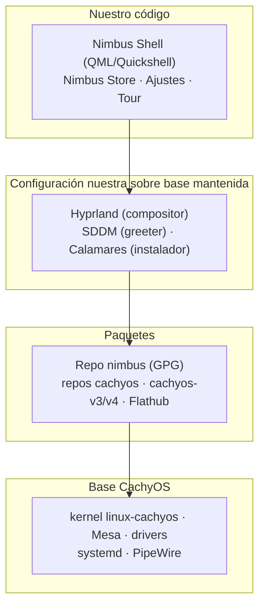

# Arquitectura de Nimbus

> **Note for English-speaking contributors:** these docs are written in Spanish first. An English version will follow.

Cómo encajan las piezas. La fuente de verdad es el [documento de diseño](superpowers/specs/2026-10-21-nimbus-design.md) (§4); aquí se resume lo implementado y se marca lo pendiente.

## Capas

En texto: el shell y las apps propias arriba; Hyprland, SDDM y Calamares en medio (mantenidos por otros, configurados por nosotros; Calamares se usa vía el fork que ya mantiene CachyOS); los repositorios de paquetes debajo; la base CachyOS al fondo. Solo la capa superior es código Nimbus.

## El modelo de pins

La base rueda; el escritorio, no. `linux-cachyos`, Mesa, systemd y los drivers siguen a los repos de CachyOS en rolling. Hyprland, Quickshell, las librerías Qt, el shell y los reempaquetados de AUR viven en el repo propio `nimbus` y solo llegan al usuario cuando se **promueven** de `testing` a `stable`.

El mecanismo: la CI compila y publica binarios en `testing` sin firmar; alguien prueba la ISO y ejecuta `tools/promote.sh` con la clave offline, que copia los paquetes a `stable`, regenera la DB con `repo-add` y la firma. Si Hyprland rompe su API, la rotura se queda en `testing` y el usuario de `stable` no se entera. El coste es real: alguien tiene que rebasear el desfase con upstream, por eso el stack pineado se mantiene lo más pequeño posible.

Qué rueda y qué se pinea, en detalle: [../packages/README.md](../packages/README.md).

## Repo y firma: `testing` frente a `stable`

- Hay un solo repo pacman (`nimbus`) con dos canales: `testing` (lo último compilado, sin garantías) y `stable` (lo promovido a mano, lo que recibe el usuario).
- La promoción es un acto manual con la clave GPG offline: `tools/promote.sh --from <testing> --to <stable> --gpgdir <disco-offline> --key <fingerprint>`. Es atómica (o se copia todo o no se copia nada) y se niega a sobrescribir una versión ya publicada.
- `tools/verify_repo.sh --repo <dir> --gpgdir <dir>` comprueba la firma de la DB y de cada paquete; un paquete sin `.sig` contigua cuenta como fallo.
- **La CI nunca firma.** Compila y prueba; la firma solo ocurre en la máquina offline. La clave maestra no existe en ningún runner, en ningún artefacto ni en ningún repositorio.
- La rotación de clave es un procedimiento de 6 pasos documentado en [../packages/README.md](../packages/README.md): generar clave nueva offline, re-firmar el repo, publicar el keyring nuevo con ambas claves, retirar la antigua.

## Cadena de confianza

1. `tools/genkeyring.sh` genera una clave RSA-4096 sin passphrase en una máquina offline y exporta la clave pública en ASCII armored (`nimbus.gpg`), más `nimbus-trusted` (ownertrust con nivel 6 para ese fingerprint) y `nimbus-revoked` (vacío, reserva para revocaciones).
2. El paquete `nimbus-keyring` instala esos tres ficheros en `/usr/share/pacman/keyrings/`.
3. Su hook `post_install` ejecuta `pacman-key --populate nimbus`, que importa la clave pública y le aplica la confianza del ownertrust.
4. `pacman` ya puede verificar las firmas de la DB (`nimbus.db.sig`) y de cada paquete del repo `nimbus`.
5. Las actualizaciones (`nimbus-update`, pendiente: hito M3) aplican `pacman -Syu` + Flatpaks con snapshot previo automático.

Sobre el formato de `nimbus.gpg`: debe ser la **exportación armored de la clave pública** (empieza por `-----BEGIN PGP PUBLIC KEY BLOCK-----`), igual que `cachyos.gpg` y `archlinux.gpg`. No sirve un keybox: `pacman-key --populate` importa el fichero con `gpg --import`, y `gpg --import` solo acepta exportaciones de clave, no bases de datos de keyring. Con un keybox responde "no valid OpenPGP data found", la clave entra sin confianza y **todas** las firmas del repo fallan. Es el tipo de detalle que rompe todo en silencio; por eso hay un test dedicado (`keyring.bats`: "nimbus.gpg es importable con gpg --import").

## Arquitectura del shell

Hoy el shell es un punto de entrada mínimo (`shell/src/main.qml`) más tres singletons registrados en `shell/src/Nimbus/qmldir` bajo el módulo `Nimbus` (se importan con `import Nimbus`):

- **`Theme`** (`shell/src/Nimbus/Theme.qml`) — tokens de diseño de solo lectura: colores de fondo/superficie/texto/separador/acento para modo claro y oscuro, material de cristal (`glass`) con su fallback opaco (`glassOpaque`), métricas (`radius` 12, `spacing` 8, `barHeight` 28, `dockSize` 64) y tipografía (`Inter`). `setMode("light"|"dark"|"auto")` cambia el esquema; `setAccent(color)` fija el acento elegido por el usuario, que gana en ambos modos.
- **`Config`** (`shell/src/Nimbus/Config.qml`) — configuración persistida con versionado (`schemaVersion`, hoy 2): `mode`, `accent` (hex en minúsculas, sin `#`), `locale` (código BCP-47). `migrateFrom(n)` migra esquemas antiguos sin romper el arranque; `translated(clave)` resuelve cadenas en el idioma activo.
- **`Translations`** (`shell/src/Nimbus/Translations.qml`) — tabla ES/EN con fallback: idioma activo → inglés → la propia clave. Nunca muestra una clave sin traducir pudiendo mostrar inglés.

La regla de **una sola verdad visual** se implementa así: todo lo visible lee de `Theme`. Cambiar el modo o el acento cambia todo el sistema de una vez, porque no hay ningún color literal fuera de los tokens.

Los módulos del escritorio (TopBar, Dock, Spotlight, Centro de Control, notificaciones, switcher, capturas, QuickLook, fondos, bloqueo, Ajustes, Store, Tour) son hito M1 y no existen aún. La biblioteca de componentes compartidos y el procedimiento para añadir un módulo nuevo están **pendientes de decidir en M1**.

### Contrato IPC (previsto, pendiente de implementar)

Definido en el plan M0 (Task 5) para cuando exista `dots/`. El shell expondrá `nimbus-shell ipc call <acción>` y Hyprland lo invocará desde sus binds:

| Tecla | Llamada | Efecto |
|-------|---------|--------|
| `SUPER`+`D` | `nimbus-shell ipc call dock toggle` | Mostrar/ocultar el Dock |
| `SUPER`+`Espacio` | `nimbus-shell ipc call spotlight toggle` | Abrir el buscador |
| `SUPER`+`Tab` | `nimbus-shell ipc call switcher next` | Cambiar de ventana |
| `Impr Pant` | `nimbus-shell ipc call screenshot region` | Captura de región |

El resto de atajos (terminal, cerrar ventana, copiar/pegar, workspaces 1–9, bloqueo, sesión de emergencia con terminal) son llamadas directas del compositor, no IPC del shell. El launcher actual (`shell/nimbus-shell`) aún no implementa el subcomando `ipc`.

### Aislamiento de fallos

Principio previsto: un módulo que falle al cargar no debe tumbar el shell entero. El mecanismo concreto (proceso separado, `Loader` con fallback, sesión de emergencia) está **pendiente de decidir en M1**; hoy no hay nada que aislar porque solo existen los singletons. Lo que sí existe es la red de seguridad de fuera del shell: si Hyprland o Quickshell rompen, el modelo de pins contiene la rotura en `testing` y los snapshots permiten rollback.

## Dónde vive cada módulo y cómo se añade uno nuevo

Hoy: `shell/src/Nimbus/*.qml` (singletons) + `shell/src/main.qml` (punto de entrada) + `shell/tests/tst_*.qml` (tests). Para registrar un singleton nuevo se añade el fichero a `shell/src/Nimbus/` y su línea `singleton <Nombre> 1.0 <Fichero>.qml` al `qmldir`; los tests lo importan con `import Nimbus` y `QML2_IMPORT_PATH` apuntando a `shell/src`. El empaquetado (`packages/nimbus-shell/PKGBUILD`) instala el árbol en `/usr/lib/nimbus/shell/` y el launcher en `/usr/bin/nimbus-shell`. La convención para módulos visuales completos (dónde cuelgan del `main.qml`, cómo se prueban aislados) se define en M1.
